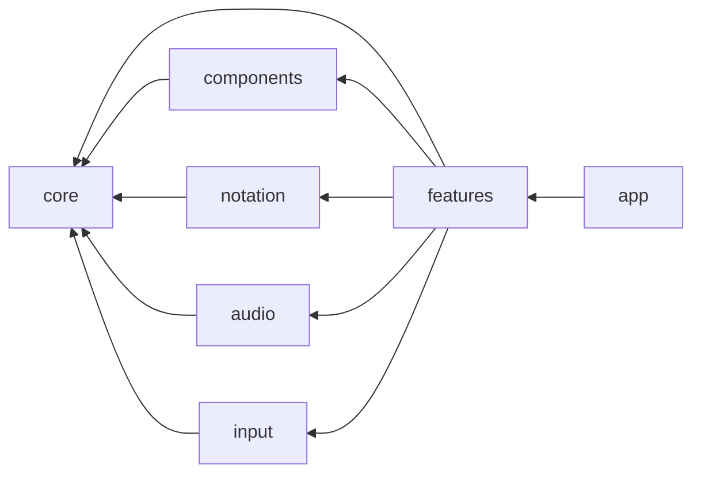
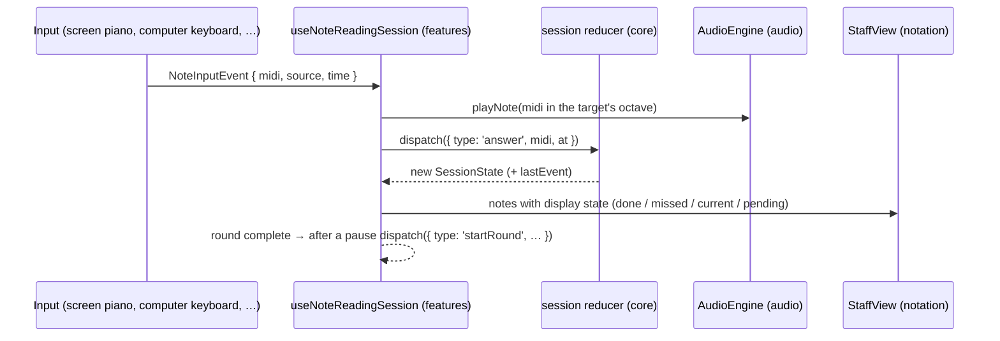

# Architecture

Solfeggio is a static single-page app (React + TypeScript + Vite) installed as a PWA.
There is no backend: everything runs in the browser, and preferences are stored in
`localStorage`. The decisions behind this shape are recorded in [decisions/](decisions/).

## Layers

```
src/
  core/         Pure TypeScript: music theory and exercise rules. No React, DOM, audio or VexFlow.
    music/        Pitch, pitch classes, MIDI, clefs and staff ranges, note naming (solfège / letters)
    exercises/    One folder per exercise type (generator, session reducer, statistics)
    random.ts     Injectable random source (seedable in tests)
  audio/        Web Audio: AudioEngine (one shared AudioContext) and the synthesized piano voice
  input/        Note input devices. Each implements NoteInputSource and emits NoteInputEvent
  notation/     VexFlow adapter and the <StaffView> component. The only place that imports vexflow
  components/   Presentational UI: Piano, SegmentedControl, Toggle, StatCard
  features/     Screens and their hooks; wire core + input + audio + notation + stores together
    noteReading/  The note-reading exercise page
    settings/     Persisted user settings (Zustand store)
  i18n/         UI strings (Italian), kept out of components
  app/          Router, providers and top-level layout
  styles/       Design tokens (light and dark) and global CSS
```

Allowed import direction (enforced by `no-restricted-imports` in `eslint.config.js`):



Cross-module imports use the `@/` alias (`@/core/music`); relative imports are only used
inside a module folder. Each module exposes its public API through an `index.ts`.

## Data flow of an exercise



Key points:

- **Core rules are pure.** The reducer receives the time (`at`) and pre-generated notes in its
  actions; the hook owns side effects (timers, randomness, audio).
- **Inputs are interchangeable.** The game only sees MIDI numbers. Today answers are compared by
  pitch class because the on-screen piano has 12 keys.
- **Notation is data-driven.** `<StaffView>` receives a clef, a list of `{ pitch, state }` and
  the index of the current note; it re-renders the SVG when they change.

## State

| State                                                                 | Where                                            | Persisted                               |
| --------------------------------------------------------------------- | ------------------------------------------------ | --------------------------------------- |
| Settings (clef, ledger lines, accidentals, naming, key labels, sound) | `features/settings/settingsStore.ts` (Zustand)   | `localStorage` key `solfeggio:settings` |
| Records (best streak)                                                 | `features/noteReading/recordsStore.ts` (Zustand) | `localStorage` key `solfeggio:records`  |
| Current round, statistics of the session                              | `useReducer` in `useNoteReadingSession`          | No                                      |

Persisted stores declare a `version`; bump it and add a `migrate` function whenever the shape changes.

## Offline and deployment

`vite-plugin-pwa` generates the manifest and a Workbox service worker that precaches the whole
build, including the Bravura music font (embedded in VexFlow's `vexflow/bravura` entry) and the
self-hosted UI fonts. CI deploys to GitHub Pages under `/solfeggio/` with hash routing
(see [0005](decisions/0005-github-pages-hosting.md)).
